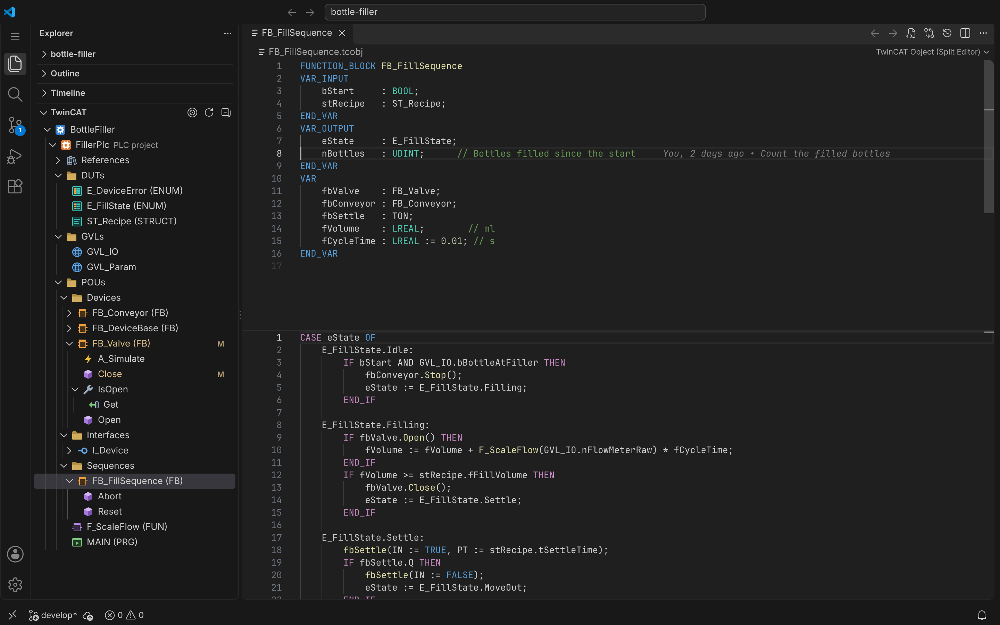
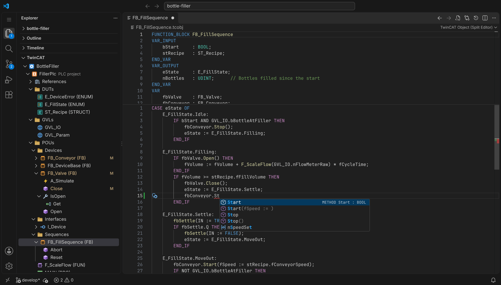
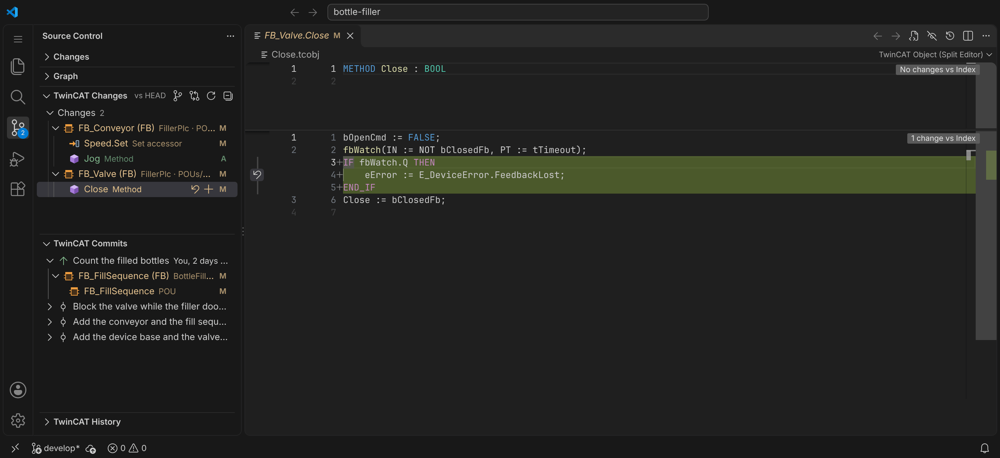
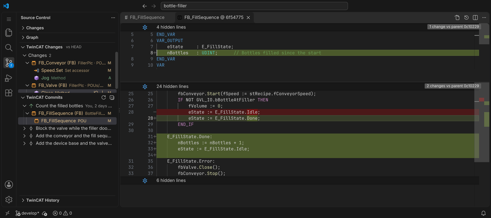
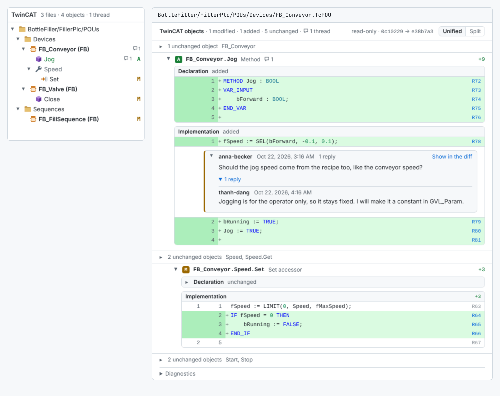
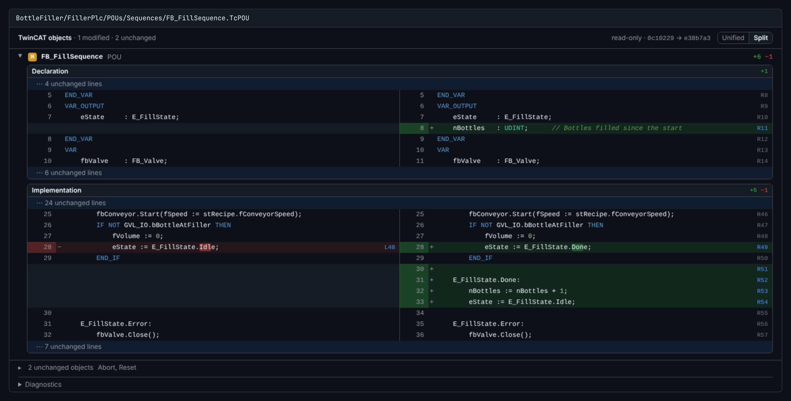

# Explorer for TwinCAT

TwinCAT 3 PLC projects in VS Code, the way TwinCAT XAE shows them. The extension adds the XAE project
tree, opens every POU, method, property and accessor in its own tab with the **Declaration above the
Implementation**, and brings Structured Text language features and git views that work per object.
The code stays in the `.TcPOU`, `.TcDUT`, `.TcGVL` and `.TcIO` XML files, and saving writes back only
the sections you edited.



<!-- browser-only:start -->
A companion [browser extension](#browser-extension) shows the TwinCAT files of a GitHub pull request or a
GitLab merge request the same way, as objects instead of XML.
<!-- browser-only:end -->

- [Features](#features)
- [Browser extension](#browser-extension) <!-- browser-only -->
- [MCP server for AI agents](#mcp-server-for-ai-agents)
- [Requirements](#requirements)
- [Installation](#installation)
- [Getting started](#getting-started)
- [Commands](#commands)
- [Keyboard shortcuts](#keyboard-shortcuts)
- [Extension settings](#extension-settings)
- [Library stubs](#library-stubs)
- [Known issues and limitations](#known-issues-and-limitations)
- [Troubleshooting](#troubleshooting)
- [Release notes](#release-notes)
- [Development](#development)
- [License](#license)
- [Trademarks](#trademarks)

## Features

### TwinCAT tree

The XAE project tree in the Explorer: the PLC projects of each `.tsproj`, their folders and objects, and
inside a POU its methods, properties, actions and transitions, with XAE's labels and icons and the git
state of each object.

<details>
<summary>Details</summary>

The **TwinCAT** view in the Explorer, below Outline and Timeline:

- One root per `.tsproj`, then its PLC projects, `References`, and the folders and objects of each
  `.plcproj`. A PLC project saved as an Independent Project File (`_Config\PLC\Plc.xti`, which the
  `.tsproj` names) shows like one the `.tsproj` holds.
- Inside a POU: the folders TwinCAT keeps in the XML (`Methods > States`), methods, properties with
  `Get`/`Set`, actions and transitions.
- Labels follow XAE (`FB_X (FB)`, `MAIN (PRG)`, `E_State (ENUM)`, `ST_Data (STRUCT)`), and modified
  files get their git colour.
- Icons in the manner of XAE's tree, in a light and a dark variant: function blocks, programs and
  functions, each kind of DUT (structure, enumeration, union, alias), GVLs, interfaces, methods,
  properties with their `Get` and `Set`, actions, transitions and tasks each have their own, and
  folders are yellow. The git views show the same icons.
- Methods, properties and accessors that differ from `HEAD` are marked `M` (changed) or `A` (new),
  like the Explorer marks files.
- Right-click a POU, an interface or a folder inside a POU to add a method, property or action (see
  [Adding methods, properties and actions](#adding-methods-properties-and-actions)).
- Right-click a method, property, action or transition to rename or delete it (F2, Delete; see
  [Renaming and deleting methods, properties and actions](#renaming-and-deleting-methods-properties-and-actions)).
- Right-click a function block, an interface, or a method or property of one: `Go to Implementation`
  opens what implements or overrides it (a list when there are several), and `Show Type Hierarchy`
  shows the supertypes and subtypes of a function block or interface (see
  [Structured Text language features](#structured-text-language-features)).
- Right-click a POU, DUT, GVL or interface to rename it, move it to another folder or delete it, or drag
  it onto a folder; a folder to rename it or move it with everything in it (see
  [Renaming, moving and deleting POUs, DUTs, GVLs, interfaces and folders](#renaming-moving-and-deleting-pous-duts-gvls-interfaces-and-folders)).
  An empty folder can be deleted too.
- Right-click a PLC project or one of its folders to add a POU, DUT, GVL, interface or folder (see
  [Adding POUs, DUTs, GVLs, interfaces and folders](#adding-pous-duts-gvls-interfaces-and-folders)), or
  files that are on disk already (see
  [Adding existing items and folder content](#adding-existing-items-and-folder-content)).
- Right-click `References` to add a library installed in the TwinCAT library repository (see
  [Adding libraries](#adding-libraries)).
- **Ctrl+Alt+T** (`TwinCAT: Go to Object...`) lists every object of the workspace.

</details>

### Split editor

Every POU, method, property and accessor in its own tab, the Declaration above the Implementation as in
XAE, with its changes against `HEAD` and the blame of the current line.

<details>
<summary>Details</summary>

- **One tab per object**, titled `FB_X`, `FB_X.Method` or `FB_X.Property.Get`.
- **Two panes, like XAE:**
  - The Declaration is in the upper pane and the Implementation in the lower one. Each pane has its
    own scroll bar, and both start at the same height.
  - Drag the bar between them to change the heights; the tab remembers it. Double-click the bar to
    get equal halves again.
- **Which tab shows what:** a property tab shows the property declaration, and its `Get` and `Set`
  open in their own tabs. DUTs, GVLs and interfaces have a single pane.
- **Opening:** a single click in the tree opens a preview tab; a double click, or an edit, keeps it.
- **Look:**
  - Breadcrumbs follow the XAE path.
  - The panes are Monaco editors (the editor VS Code is built on). They use your VS Code font, tab
    and theme settings and the same colours.
- **Changes vs HEAD:**
  - Each pane marks its changed lines in the gutter (green: added, blue: changed, red wedge:
    removed), unsaved edits included. `Alt+F5` and `Shift+Alt+F5` go to the next and previous
    change.
  - `Show Changes vs HEAD` (editor title button, or a click on a change marker) turns both panes into
    inline diffs against `HEAD`. Unchanged lines are folded, the panes stay editable, and the
    `Revert Block` button next to a change puts the `HEAD` text back.
  - `Hide Changes vs HEAD` returns to the normal panes. A commit, checkout or rebase updates the
    comparison.
- **Line blame**, like GitLens' current line blame:
  - The end of the current line shows who changed it last, when, and the commit message
    (`You, 2 days ago • Fix the purge timer`).
  - The hover adds the date, `Open Changes` and `Show History`. `Open Changes` shows the commit's
    changes of this object in the commit diff panel.
  - Lines changed since `HEAD`, saved or not, show `Uncommitted changes`.
  - Off by default: `TwinCAT: Toggle Line Blame` or the setting `twincatExplorer.blame.currentLine` turns it on.

</details>

### Safe saving

Saving replaces only the sections you edited and keeps every other byte of the file. A section changed on
disk meanwhile is never overwritten.

<details>
<summary>Details</summary>

- **Edited sections only:** only the CDATA of the sections you edited is replaced. BOM, CRLF, GUIDs
  and every other byte of the file stay as they were.
- **Outside changes survive:** sections you did not touch are never written back, so changes made
  meanwhile in XAE or by git are kept.
- **Conflicts are refused:** if a section you edited was also changed on disk, the save is refused
  with a message instead of overwriting it.
- **Several tabs:** two tabs of the same file can be edited and saved independently.
- **Reloads:** open tabs without unsaved edits reload when the file changes on disk. Undoing back to
  the text on disk makes the tab clean again.
- **Renaming is blocked:** changing the name in a declaration header (`METHOD OnEntry` to
  `METHOD OnEnter`) makes the save fail with a message. Rename the object with Rename Symbol (F2) on
  its name, or Rename... in the TwinCAT tree, instead (see
  [Renaming and deleting methods, properties and actions](#renaming-and-deleting-methods-properties-and-actions)
  and [Renaming, moving and deleting POUs, DUTs, GVLs, interfaces and folders](#renaming-moving-and-deleting-pous-duts-gvls-interfaces-and-folders)).

</details>

### Saving through TwinCAT XAE

On Windows, when a running TwinCAT XAE has the project open, saving an object in the split editor or an
object notebook sets the edited sections in XAE instead of writing the file. XAE shows the change at once,
saves the object itself, and never asks to reload it or writes its older copy back. With XAE closed the
file is written as before.

Off by default: turn it on with `twincatExplorer.saveThroughXae`. Off, saves write the file and never ask
XAE anything.

<details>
<summary>Details</summary>

- **Unsaved edits in XAE are asked about:** setting a section makes XAE save the whole object. If XAE has
  unsaved edits of the section you save, a dialog says that the save replaces them; if it has unsaved
  edits of another section of the object, that XAE saves them along. Cancel leaves both as they were and
  the tab unsaved.
- **Undo:** VS Code's undo works as usual. XAE's Ctrl+Z does not take back a change set this way, and the
  undo history of XAE's editor of that object is gone.
- **XAE's copy must have the object's members:** XAE writes the object as it has it, so a save is refused
  when XAE's copy lacks a method, property or action that the file has, or has one the file has not (for
  example after "Reload the new file?" was answered No in XAE). Reload the project in XAE, then save again.
- **A dialog open in XAE** blocks it: after 15 seconds the save fails with the dialog's text, and the file
  is not written. Close the dialog and save again.
- **Errors:** a section XAE refuses makes the save fail with XAE's message; the sections set before it are
  saved. Save again to retry.
- **Speed:** a save takes about one second more, while XAE has the project open. The first one after
  installing compiles a small helper (about 2 seconds).
- **XAE running but not reachable** (its automation assemblies or the .NET Framework's compiler missing):
  the file is written, with a warning once.
- Only saves of objects go through XAE. Adding, renaming, moving and deleting objects and members (and
  the uses a rename changes), and the `TwinCAT File (Notebook)` editor still write the files.

</details>

### Adding methods, properties and actions

Add a method, property or action to a POU or an interface from the TwinCAT tree, written as XAE writes
it.

<details>
<summary>Details</summary>

- **Add Method...**, **Add Property...** and **Add Action...** are in the context menu of a POU or
  interface in the TwinCAT tree, and of a folder inside a POU. From the Command Palette they add to the
  object of the active editor. Actions are for function blocks and programs.
- **What they ask:** the name, checked against the other members (case aside); the return type of a
  method (empty for none) or the type of a property; and whether a property gets `Get` and `Set` or one
  of them.
- **What they write**, as TwinCAT XAE 3.1.4026 does:
  - A new GUID and the declaration XAE gives a new member: `METHOD Start : BOOL` (with an empty
    `VAR_INPUT` in an interface), `PROPERTY PUBLIC Speed : LREAL` (`PROPERTY Speed : LREAL` in an
    interface), an empty `VAR` block in `Get` and `Set`.
  - An empty Structured Text implementation. Members of an interface have none.
  - `FB_init` and `FB_exit` get the inputs the compiler requires (`bInitRetains`, `bInCopyCode`).
  - The new element takes the file's indentation and line breaks, and the file keeps its BOM. The rest
    of the file stays byte-identical.
  - It goes where XAE keeps it: XAE orders the members by name whatever their kind (case aside,
    underscores before digits before letters). In a file whose members are not in that order, it goes
    after the last one.
- **Then:** the tree shows the new member and it opens in the split editor, or the notebook if
  `twincatExplorer.editor` says so. A new property opens at its `Get` (or `Set`).
- **Implement Interfaces...** on a function block with `IMPLEMENTS`: picks from the methods and
  properties of its interfaces, and of the interfaces these extend, that neither the function block
  nor one it extends has yet. Each gets the declaration it has in the interface and an empty
  implementation.
- A file with unsaved changes in an editor is refused: save or revert them first. To take back a new
  member, use Discard Changes in the TwinCAT Changes view.

</details>

### Renaming and deleting methods, properties and actions

Rename or delete a method, property, action or transition from the TwinCAT tree.

<details>
<summary>Details</summary>

- **Rename...** (F2) and **Delete** (Delete) are in the context menu of a method, property, action or
  transition in the TwinCAT tree. Delete is also on the `Get` and `Set` of a property.
- **Rename** asks for the new name, checked like the name of a new member. Then, as TwinCAT XAE
  3.1.4026 does, it changes:
  - The name of the member in the file and in its declaration (`METHOD M_Start : BOOL`).
  - The name inside the member where it stands for the member itself: a method's return value
    (`M_Start := TRUE;`), a property's value in its `Get` and `Set`.
  - Its `LineIds` and those of its accessors, in files that have them.
  - Its place: XAE keeps the members in name order, so a renamed member moves to its new place.
- **What uses the member elsewhere takes the new name too**, as with XAE's rename: its calls
  (`fbPump.M_Start()`, `THIS^.M_Start()`, `SUPER^.M_Start()`, through an interface or a GVL) and the
  uses of a property (see [Renaming with the uses](#renaming-with-the-uses)).
- **Implementations and overrides:** for a method or property of an interface, or one that function
  blocks implement or override, a list of these comes first: the checked ones are renamed with it,
  their uses too.
- **Delete** asks first. Then it removes the member, or the accessor, from the file with its
  `LineIds`, as XAE does. What uses it is not changed.
- The rest of the file stays byte-identical. Open tabs of the member open again under its new name, or
  close when it is deleted.
- A file with unsaved changes in an editor is refused. To take back a rename or a delete, use Discard
  Changes in the TwinCAT Changes view.

</details>

### Adding POUs, DUTs, GVLs, interfaces and folders

Add a POU, DUT, GVL, interface or folder to a PLC project, written as XAE writes it.

<details>
<summary>Details</summary>

- **Add POU...**, **Add DUT...**, **Add Global Variable List...**, **Add Interface...** and **New
  Folder...** are in the context menu of a PLC project and of its folders in the TwinCAT tree. From the
  Command Palette they add to the folder of the active editor's object, or to a PLC project picked.
- **What they ask:**
  - Add POU: function block, program or function; the name; the return type of a function; the
    function block a function block extends and the interfaces it implements (both may stay empty).
  - Add DUT: structure (and the structure it extends), enumeration, union or alias (and its type); the
    name.
  - Add Global Variable List: the name. Add Interface: the name and the interfaces it extends.
  - The name must be an identifier that no POU, DUT, GVL or interface of the PLC project has (case
    aside), with no file of that name in the folder. A base the project does not know only gets a
    warning: it may come from a library without a stub.
- **What they write**, as TwinCAT XAE 3.1.4026 does:
  - The file of the object (`.TcPOU`, `.TcDUT`, `.TcGVL`, `.TcIO`) in the folder, with a new GUID and
    the declaration XAE gives a new object: for example `FUNCTION_BLOCK FB_Pump EXTENDS FB_Base
    IMPLEMENTS I_Pump` with empty `VAR_INPUT`, `VAR_OUTPUT` and `VAR` blocks, `TYPE ST_Data:` with an
    empty `STRUCT`, or `VAR_GLOBAL` and `END_VAR`.
  - The file gets the XML header, line breaks and BOM of the other files of the project.
  - A function block that implements interfaces gets their methods and properties, as with Implement
    Interfaces.
  - The `.plcproj` gets the `<Compile>` item of the file, or the `<Folder>` item of a folder, where XAE
    puts it; the rest of the `.plcproj` stays byte-identical. New Folder also makes the folder on disk.
- **Then:** the tree shows the new object or folder, and a new object opens in the split editor.
- A `.plcproj` with unsaved changes in an editor is refused. A TwinCAT XAE 3.1.4026 that has the
  project open asks whether to reload the changed `.plcproj`: answer Yes.

</details>

### Adding existing items and folder content

Add files that are already on disk to a PLC project, like XAE's Add > Existing Item and Existing Folder
Content.

<details>
<summary>Details</summary>

- **Add Existing Item...** and **Add Existing Folder Content...** are in the context menu of a PLC
  project and of its folders in the TwinCAT tree, like XAE's Add > Existing Item and Existing Folder
  Content. From the Command Palette they add to the folder of the active editor's object, or to a PLC
  project picked.
- **Add Existing Item...** picks `.TcPOU`, `.TcDUT`, `.TcGVL` and `.TcIO` files, several at once.
  **Add Existing Folder Content...** picks a folder: its files and those of its sub-folders, a sub-folder
  going into a sub-folder of the same name.
- **What they do**, as TwinCAT XAE 3.1.4026 does:
  - A file in the folder on disk already, but not in the `.plcproj` (after a merge, or copied by hand),
    gets its `<Compile>` item and stays where it is. Any other file is copied into the folder, byte for
    byte.
  - An object whose GUIDs the PLC project has already, a copy of one of its POUs for example, gets new
    ones for those GUIDs only; the rest of the file stays as it was.
  - The `<Compile>` items, and the `<Folder>` items of new sub-folders, go where XAE puts them.
- **What is skipped**, with the reason in the message after it: files that are not POUs, DUTs, GVLs or
  interfaces (XAE adds other files as `<None>` items), files that cannot be read or hold no such object,
  an object whose name the PLC project has already (POUs, DUTs, GVLs and interfaces share one namespace,
  case aside), a file in the project already, and a file that would go over one on disk.
- **Then:** the tree shows the new objects and selects the first one. A `.plcproj` with unsaved changes
  in an editor is refused.

</details>

### Adding libraries

Add a library installed in the TwinCAT library repository to the `References` of a PLC project, like
XAE's Library Manager.

<details>
<summary>Details</summary>

- **Add Library...** is in the context menu of `References` of a PLC project in the TwinCAT tree, like
  XAE's Library Manager > Add library. From the Command Palette it adds to the PLC project of the active
  editor's object, or to a PLC project picked.
- **It lists the libraries installed in the TwinCAT library repository**, read without XAE:
  `C:\ProgramData\Beckhoff\TwinCAT\PlcEngineering\Managed Libraries` with TwinCAT 3.1.4026,
  `%TWINCAT3DIR%Components\Plc\Managed Libraries` with 3.1.4024 and older, and the folders of
  `twincatExplorer.libraryRepositories` (repositories added in XAE's Library Repository dialog).
  - One entry per library and company: its title, company and newest version, its namespace and
    categories. Typing filters on all of them.
  - A library the PLC project references already, by either kind of reference, is marked and refused.
- **Then the version:** `Always newest (*)`, XAE's default, or one of the installed versions.
- **What it writes**, as TwinCAT XAE 3.1.4026 does, for the libraries of every company:

  ```xml
  <PlaceholderReference Include="Tc2_Utilities">
    <DefaultResolution>Tc2_Utilities, * (Beckhoff Automation GmbH)</DefaultResolution>
    <Namespace>Tc2_Utilities</Namespace>
  </PlaceholderReference>
  ```

  - The placeholder is the one the repository's profile gives the library (Beckhoff's libraries have
    their title), else the title. The default resolution has the version picked, `*` for always the
    newest. The namespace is the library's default namespace.
  - The reference goes among the others in alphabetical order, as XAE keeps them; the rest of the
    `.plcproj` stays byte-identical.
- **Then:** the tree selects the new library under `References`, and the language features know the
  symbols of its [stub](#library-stubs), if there is one. A `.plcproj` with unsaved changes in an
  editor is refused, and so is a workspace without a repository, with the folders looked in.

</details>

### Renaming, moving and deleting POUs, DUTs, GVLs, interfaces and folders

Rename, move or delete objects and folders from the TwinCAT tree, or drag them onto a folder.

<details>
<summary>Details</summary>

- **Rename...** (F2), **Move to Folder...** and **Delete** (Delete) are in the context menu of a POU,
  DUT, GVL or interface in the TwinCAT tree; Rename... and Move to Folder... also in that of a folder.
  Dragging one onto a folder of its PLC project, or onto the project, moves it there after a
  confirmation. Delete is also on an empty folder.
- **Rename** of an object asks for the new name, checked like the name of a new object. Then, as TwinCAT
  XAE 3.1.4026 does, it changes:
  - The file, renamed in its folder (`FB_Pump.TcPOU` to `FB_Motor.TcPOU`), and its `<Compile>` item in
    the `.plcproj`, which stays where it is.
  - The name of the object in the file and in its declaration (`FUNCTION_BLOCK FB_Motor`; a GVL
    declares none), its `LineIds` and those of its members.
  - Inside a function, its return value (`F_Sum := nA + nB;`).
  - The call of a task that calls a renamed program (`<PouCall>` in its `.TcTTO`).
- **What uses the object elsewhere takes the new name too**, as with XAE's rename: declarations
  (`fbPump : FB_Pump;`, `POINTER TO`, `ARRAY OF`), `EXTENDS` and `IMPLEMENTS`, calls, names qualified by
  a GVL (`GVL_Main.nCount`) and the types in DUTs and GVLs (see
  [Renaming with the uses](#renaming-with-the-uses)).
- **Rename** of a folder renames it on disk. Its `<Folder>` item and the items of everything in it take
  the new path where they are, as XAE renames a folder. Nothing in the files changes.
- **Move to Folder...** picks a folder of the PLC project, or the project itself. The file, or the
  folder with everything in it, moves on disk, and its items take the new path where they are.
- **Delete** asks first. Then the file goes to the Recycle Bin and its item out of the `.plcproj`, as
  in XAE. What uses the object is not changed: a task that calls a deleted program still calls it, as
  after a delete in XAE. An empty folder leaves the `.plcproj`, and the disk when nothing else is in it.
- The rest of each file stays byte-identical. Open tabs open again under the new name or path, or close
  when their object is deleted.
- The `.plcproj`, the files that move and the tasks that change must have no unsaved changes in an
  editor. To take a change back, use git: the TwinCAT Changes view shows the files, and the `.plcproj`
  under Project files.

</details>

### Renaming with the uses

Rename (F2) changes the uses too, in every PLC project of the workspace.

<details>
<summary>Details</summary>

- **Rename...** in the TwinCAT tree and **Rename Symbol** (F2) in the split editor and in notebook
  cells change what they rename and its uses in every PLC project of the workspace, as the language
  index finds them.
- **F2** renames what the name under the cursor stands for: a variable; an input or output, also as a
  named parameter (`fbPump(nSpeed := 5)`) and as a member (`fbPump.nSpeed`); a DUT field; an enum
  value (`E_State.Idle`, `E_State#Idle`). POUs, DUTs, GVLs, interfaces and members it renames as the
  TwinCAT tree does.
- **Before writing**, a list shows each object whose code changes, by file, with the number of changes
  and the first changed line. Uncheck an object to leave it with the old name. A rename that changes
  nothing outside what it renames writes at once.
- **When the new name would change what other code means** (a variable renamed to the name of another
  one that its uses would then mean, or that a local variable would hide), a warning names the places
  first: Rename Anyway, or Show Places.
- **What is written:** only the CDATA of the sections that change. Every other byte of each file stays
  as it was, its BOM and line breaks too. Comments and strings keep the old name.
- **After it**, the message says how many places changed, and what keeps the old name: places the
  language index does not resolve (Show Places lists them), and implementations in other languages
  (CFC, SFC, FBD, LD, IL) and other files (visualizations) that have it, to change in TwinCAT XAE.
- A file with unsaved changes in an editor is refused; F2 in a tab with unsaved changes offers to save
  it first. To take a rename back, use Discard Changes in the TwinCAT Changes view.

</details>

### Structured Text language features

These work in both panes and in notebook cells. They come from a parser of the TwinCAT dialect
(`EXTENDS`, `IMPLEMENTS`, `THIS^`, `SUPER^`, properties, `REFERENCE TO`, ...).



<details>
<summary>Details</summary>

- **Go to Definition** (F12, Ctrl+click), including members reached through variable types and
  inheritance. `fbValve.Open()` opens the `Open` method of `FB_Valve`, or of the function block it
  extends, at the method name; a local variable moves the cursor to the declaration pane.
- **Hover** with the declaration, its comments and where it is declared.
- **Completion** after `.` (members, inherited members, enum values) and of the names in scope.
  - **Calls with their arguments**, like `Insert with arguments` in XAE's Input Assistant: next to a
    function block instance, function, program, method or action, a second item inserts the call with
    all its parameters, inputs with `:=` and outputs with `=>`, and a tab stop for each value:
    `fbTimer(IN := , PT := , Q => , ET => );`. Where a statement starts the call ends with `;`; a
    call without a value (of an instance, a program, an action) is offered only there.
  - **Snippets** for `IF`, `IF ELSE`, `IF ELSIF ELSE`, `ELSIF`, `CASE`, `FOR`, `WHILE` and `REPEAT`
    where a statement starts, and for `{region "..."}` ... `{endregion}` on a line of its own.
- **Signature help** after `(` and `,` in a call of a function, function block instance, program,
  method, action or built-in (`LIMIT`, `MID`, `INT_TO_REAL`, ...): the inputs as declared
  (`PT : TIME := T#1S`), the outputs with `=>` (`Q => BOOL`), and the declaration and comment of the
  parameter at the cursor. That parameter follows the argument's position, or the name being typed.
  An action shows the inputs and outputs of its function block; a declaration shows those of `FB_init`
  (`fbValve : FB_Valve(`). `Ctrl+Shift+Space` shows it again, as in XAE.
- **Highlights at the cursor**: on a keyword, the others of its block (`IF`, `THEN`, `ELSIF`, `ELSE`,
  `END_IF`; `CASE ... OF ... ELSE ... END_CASE`; `FOR ... TO ... BY ... DO ... END_FOR` with the loop's
  `EXIT` and `CONTINUE`; `VAR_INPUT ... END_VAR`, `STRUCT ... END_STRUCT`, ...); on a name, its uses, those
  that write it (`:=`, `=> bDone`, `S=`, `REF=`, its declaration) apart from those that read it, in both panes
  of the split editor: on `bDone` in the implementation, its declaration above too. On a bracket, the one
  that matches it.
- **Folding** by the blocks of the code, not by indentation: `IF ... END_IF` and each of its branches
  (`ELSIF`, `ELSE`), `CASE`, `FOR`, `WHILE`, `REPEAT`, `VAR ... END_VAR`, `STRUCT`, `UNION`, `TYPE`, comments
  over several lines and `{region}` ... `{endregion}`. Fold All (`Ctrl+K Ctrl+0`) and the fold levels
  (`Ctrl+K Ctrl+2`) follow them. `editor.foldingStrategy` set to `indentation` folds by indentation instead.
- **Go to Symbol** (`Ctrl+Shift+O`; type `@:` to group by kind) and the outline of notebook cells: in a
  declaration, the POU, method or type with its `VAR` blocks (`VAR_INPUT`, `VAR CONSTANT`, ...) and their
  variables, members and enumeration values; in an implementation, the branches of each `CASE` (the steps
  of a state machine) with the comment on their line, as `20 — Wait for the axis`, which can be searched
  for; and the `{region}`s of both.
- **Find All References**: Shift+F12 opens a peek view. Other objects are shown read-only there;
  double-click a result to open it.
- **Go to Implementation** (Ctrl+F12; Ctrl+Shift+F12 peeks): on an interface, the function blocks that
  implement it, directly, through an interface that extends it or by extending one that implements it;
  on a function block, those that extend it, at any depth; on a method or property, also at a call
  through an interface (`itfValve.Open()`), the methods and properties of these function blocks that
  implement or override it. Other objects are shown read-only in a peek view. A library's function
  block or interface lists what extends or implements it in the workspace.
- **Type hierarchy**: notebook cells have VS Code's `Show Type Hierarchy`. In the split editor (context
  menu, at the cursor; the editor title's `...` menu, for the object) and the TwinCAT tree,
  `TwinCAT: Show Type Hierarchy` shows a function block or interface with its supertypes (`EXTENDS` and
  `IMPLEMENTS`, up to the roots) and its subtypes (what extends or implements it) in VS Code's
  References view; a click opens the split editor there. Without VS Code's built-in References view
  extension, a quick pick lists them.
- **Rename Symbol** (F2): the name under the cursor and its uses (see
  [Renaming with the uses](#renaming-with-the-uses)).
- **Problems**, reported while you type in the editor and in the Problems panel: syntax errors,
  unknown identifiers, unknown members and unknown named parameters. A click in the Problems panel
  opens the split editor at the problem.
- **Quick fixes** (light bulb, `Ctrl+.`), as XAE's Auto Declare:
  - An unknown identifier: `Declare bDone in VAR`, `in VAR_INPUT`, `in VAR_OUTPUT`, `in VAR_IN_OUT`
    and `in VAR_TEMP`, the blocks the object can have (`VAR_GLOBAL` in a GVL; an action declares in its
    POU). The type comes from the use: `TRUE` or a condition gives `BOOL`, `1.5` `LREAL`, `5` `INT`
    (`DINT` or `LINT` when larger), `16#FF` `WORD`, `'text'` `STRING`, `T#1s` `TIME`; a variable, call
    or parameter gives its type. Otherwise `BOOL`, which XAE's dialog starts with.
  - `bDone : BOOL;` goes before the `END_VAR` of the block, indented like its declarations; a missing
    block is added. It is an edit of the declaration pane or cell: `Ctrl+Z` there takes it back, and
    saving writes it.
  - A member that a function block, program or interface of the workspace lacks (`fbValve.M_Reset()`):
    `Add method M_Reset to FB_Valve` or `Add property ...`, the one the use asks for first. It gets the
    type of the use and opens.
- **Auto Declare...** (`Shift+F2`, as in XAE, or the context menu) asks for the scope (`CONSTANT`,
  `RETAIN` and `PERSISTENT` blocks too), name, type, initial value and comment. It starts with the
  unknown name at the cursor and the type of its use.
- **Ctrl+T** finds POUs, methods, properties, DUTs, GVLs and global variables, and opens the split
  editor at the symbol.
- **Outline** of the declared variables (notebook cells).
- **`TwinCAT: Check All Structured Text`** analyses every section of every project and reports the
  problems on the XML files.

</details>

### Source Control views

Three views in the Source Control sidebar that work per object instead of per file: **TwinCAT Changes**
(uncommitted and branch changes, staged object by object), **TwinCAT Commits** (like GitLens' commits view)
and **TwinCAT History** (the commits that changed one object).





<details>
<summary>Details</summary>

**TwinCAT Changes** lists the objects that differ (POU, methods, properties, accessors), grouped by POU
and marked `M`, `A` or `D`.

- **Two scopes,** switched in the view's title bar:
  - uncommitted changes (vs `HEAD`), in two lists as in Source Control: `Staged Changes` (`HEAD` ↔
    index) and `Changes` (index ↔ working tree);
  - branch changes since the merge base with another branch, what a merge request shows.
    `origin/develop` is the default; `Compare Branch With...` picks another one. Uncommitted changes
    are included.
- **Opening:** a click opens the object in the split editor with the diff against that base, at its
  first change. A deleted object opens as read-only text of its old version.
  - In `Changes`, the base is the index.
  - In `Staged Changes`, the object opens read-only in the commit diff panel, `HEAD` ↔ index.
- **`Stage Changes` (`+`) and `Unstage Changes` (`−`)** on an object or a file, to commit the change of
  one method, property, accessor, action, DUT or GVL alone. `Stage All Changes` and `Unstage All
  Changes` are on the lists.
  - Staging an object puts it in the index as it is in the working tree: its code and name, or the whole
    member when it is new or deleted. The rest of the index's version of the file stays byte for byte,
    its line endings too (CRLF, `.gitattributes`).
  - Unstaging puts it back as in `HEAD`.
  - A new, deleted or renamed file is staged whole (`git add`, `git rm --cached`), and so are the build
    output and the project files. A file with a merge conflict is staged whole once its conflict
    markers are gone, which marks it resolved.

  Staging is refused while an editor has unsaved edits of the file.
- **`Discard Changes`** (in `Changes`), back to the version in the index, which is `HEAD`'s unless
  changes are staged:
  - the code and name of an object go back;
  - a new method, property, action or accessor is removed, a deleted one comes back;
  - a whole file goes back, in the working tree; what is staged stays.

  It is refused while an editor has unsaved edits of the file.
- **`Build output (no code changes)`** gathers files whose change is only XAE metadata: a `.tsproj`, or
  the `.xti` of a PLC project, with only new `TmcHash` values, or a source file with only a new
  `ProductVersion`. They can be discarded too.
- **`Project files`** holds the other `.tsproj`/`.plcproj`/`.xti` changes; a click shows their XML diff.

**TwinCAT Commits** works like the commits view of GitLens.

- **The list:**
  - Every commit of `HEAD`, newest first, as `git log` lists them, 30 at a time
    (`Load more commits...`), with author and age.
  - An arrow marks the commits no remote has yet, and merges have their own icon.
  - Copy the SHA or the message from the context menu.
- **A commit expands to the files it changed:** its POUs first, each expanding to the objects the
  commit changed (`M`, `A`, `D`), then the project files and every other file. A merge lists its
  changes against its first parent, which is what it brought into the branch.
- **Opening a changed object:** a click shows what the commit changed in it, in the split editor's
  layout (Declaration above Implementation). The view is read-only, against the commit's first
  parent, at the first change.
  - The next object replaces it in the same tab.
  - `Open Current Version` (editor title) opens the object as it is now.
- **Opening other files:** any other file (project files, and POU files with only a rename or a
  metadata change) opens in VS Code's diff editor, as in GitLens. An added or deleted file is
  compared with an empty one. A POU's whole file opens as a notebook diff from its inline button.

**TwinCAT History** is like GitLens' file history, but per object.

- **Which commits:**
  - The commits of `HEAD` that changed one method, property, accessor, action, DUT or GVL, newest
    first, 50 at a time, back to the commit that created it.
  - The file is followed through renames and moves (`git log --follow`). Commits that changed only
    other objects of the file, or only metadata, are left out.
  - For a POU with methods or properties, the view lists the commits that changed any of its
    objects, each expanding to them.
- **Which object:**
  - The view shows the object of the active split editor or object notebook; `Pin to This Object`
    (view title) keeps it.
  - `Show History` is in the TwinCAT tree's context menu, in the title bar of the split editor and of
    the commit diff panel, and on the objects of the Changes and Commits views.
- **Opening:**
  - A click on a commit shows what it changed in the object, in the commit diff panel.
  - `Compare with Working Version` opens the object's split editor with its changes since that
    commit.
  - `Uncommitted changes` at the top opens the diff against `HEAD`.

</details>

### Notebooks

An object or a whole file as a notebook, one cell per section, and a notebook diff of a whole file
against git.

<details>
<summary>Details</summary>

- **Object notebook:** set `twincatExplorer.editor` to `notebook`, or use
  `Reopen Editor With... > TwinCAT Object (Notebook)` on a tab. Each section is one cell.
- **Whole-file notebook:** `Reopen Editor With... > TwinCAT File (Notebook)` shows a whole `.TcPOU` as
  one notebook.
- **Notebook diff for git:** `Open Changes as TwinCAT Notebook` compares a whole file with `HEAD`
  section by section, folding the unchanged sections. In Staged Changes it compares `HEAD` with the
  index.
  - The command is in the tree, Explorer and Source Control menus, and in the `...` menu of a split
    editor tab.
  - Staged renames are followed, and an open comparison refreshes after a commit, checkout or stage.
  - `Compare with Git Ref as TwinCAT Notebook...` compares with any branch or commit, for example
    `origin/develop` when you review a merge request.
- **Toolbars:** the extension hides the cell toolbar of TwinCAT notebooks. VS Code has no switch per
  notebook type for the rest (`Run All`, `Select Kernel`, `+ Code`, `+ Markdown`), so
  `TwinCAT: Hide Notebook Toolbars (XAE-like Layout)` hides the top toolbar and the insert buttons
  for every notebook. It changes `notebook.globalToolbar` and `notebook.insertToolbarLocation` in the
  user settings, and the same command shows them again.

</details>

<!-- browser-only:start -->
## Browser extension

A read-only extension for Chrome, Edge and Firefox, in [`browser/`](browser), for code review: on a GitHub pull
request's *Files changed* tab or a GitLab merge request's *Changes* tab, a changed `.TcPOU`, `.TcDUT`,
`.TcGVL` or `.TcIO` file shows as TwinCAT objects instead of XML, in the layout of the commit diff panel.

<details>
<summary>Details</summary>

- **TwinCAT view:** a toggle in the header of each TwinCAT file replaces the host's XML diff with the
  objects the change touched (POU, methods, properties, accessors, actions, transitions), each marked
  `M`, `A` or `D`, its Declaration diff above its Implementation diff. Unchanged objects and lines are
  folded.
- **Review threads** show under the lines they are on, and every line links to its XML line in the
  host's own diff, where comments are written.
- **Unified or Split**, following the host's own diff setting, with Structured Text highlighting and
  word-level changes.
- **TwinCAT tab:** above the host's file tree, the change as XAE's Solution Explorer shows a project,
  with the number of threads on each object. A click opens that object's view.

</details>





It is released apart from the VS Code extension, as a zip attached to the `browser-v*`
[GitHub releases](https://github.com/ddt313/TwinCAT-Explorer/releases), and loaded unpacked
(`chrome://extensions` or `edge://extensions`, developer mode, *Load unpacked*); Firefox 140 or later
installs it from [addons.mozilla.org](https://addons.mozilla.org/firefox/addon/explorer-for-twincat/). How to build it, use it
on a self-managed GitLab instance and what it reads is in [`browser/SPIKE.md`](browser/SPIKE.md); its
changes are in [`browser/CHANGELOG.md`](browser/CHANGELOG.md).
<!-- browser-only:end -->

## In the browser (vscode.dev)

The extension also runs in VS Code in the browser: open a repository on [vscode.dev](https://vscode.dev) (for
example `https://vscode.dev/github/<owner>/<repo>`) or press `.` on its GitHub page (github.dev), and install
**Explorer for TwinCAT** there. The TwinCAT tree, the split editor, the object notebooks, the Structured Text
features and editing work as on the desktop; saving writes the repository's files as VS Code in the browser does
(GitHub Repositories keeps them until you commit them there).

- The `.tsproj`, `.plcproj`, `.xti` and TwinCAT source files are read when the workspace opens (the status bar
  shows *Reading the TwinCAT files*). The repository is downloaded in one go first, as GitHub Repositories does to
  search it; a large repository takes a moment.
- Deleting a POU, DUT, GVL or folder deletes it without the Recycle Bin: until it is committed, Source Control can
  discard the deletion.
- **Changes vs HEAD:** *Open Changes as TwinCAT Notebook* and the split editor's *Show Changes vs HEAD* compare
  with HEAD as GitHub has it (the commit of the branch, tag or pull request open), read through GitHub's API. A
  public repository needs no sign-in; a private one asks to sign in with GitHub (the Accounts menu) once.
- **TwinCAT Changes:** in the Source Control sidebar, what the branch changed since the base branch of the pull
  request open (press `.` on a pull request's page to open it in github.dev), else since the default branch, object
  by object, changes not committed included. *Compare Branch With* picks another branch, tag or commit.
- **TwinCAT Commits:** the commits of HEAD, each with the objects it changed, and *Compare with Git Ref* against a
  branch, tag or commit, from GitHub.
- **TwinCAT History and blame:** the commits that changed an object (a rename of its file ends the list there) and the
  line blame of the split editor come from GitHub; blame needs a sign-in with GitHub, even for a public repository.
- **Not in the browser:** staging needs git's index,
  and the MCP server needs Node; they are hidden there. Libraries installed with TwinCAT are not found either:
  use stub files (`twincatExplorer.stubFiles`) from the repository.

## MCP server for AI agents

An [MCP](https://modelcontextprotocol.io) server gives an AI agent (Claude Code, or another MCP client)
the TwinCAT projects of a folder the way the split editor shows them, so that it never reads or edits the
`.TcPOU` XML as text. It runs on its own, without VS Code. To give it to Claude Code, run
`TwinCAT: Set Up MCP Server for Claude Code` in the folder of a TwinCAT repository, once.

<details>
<summary>Details</summary>

- **Set Up MCP Server for Claude Code** runs Claude Code's `claude mcp add twincat --scope local` in the
  workspace folder (it asks which one when there are several), with the `out/mcp/server.js` of the
  installed version:
  - Local scope: the setting is in your `~/.claude.json`, for that folder and for you only; nothing is
    written to the repository. Claude Code sessions started in that folder from then on have the tools
    (`mcp__twincat__*`).
  - The server runs with `node` when it is on PATH, else with VS Code's own Electron as Node, so Node
    need not be installed.
  - The path changes with every version of the extension: after an update, a message offers to set the
    server up again for the folders that had it.
  - Without `claude` on PATH, the command puts the command line on the clipboard instead. By hand, in the
    folder: `claude mcp add twincat -- node "<extension folder>/out/mcp/server.js"` (or
    `out/mcp/server.js` of a build of this repository).
  - It then asks which permission rules the folder's own Claude Code settings,
    `.claude/settings.local.json`, get (both are picked; none leaves the file as it is):
    - The reading tools (`mcp__twincat__read`, `mcp__twincat__references`, ...) run without asking.
    - Claude Code's Edit and Write tools refuse `.TcPOU`, `.TcDUT`, `.TcGVL` and `.TcIO` files
      (`Edit(**/*.TcPOU)`, ... in `deny`), so that code changes go through the server. A workflow that
      edits these files some other way, such as a script run through Bash, may be refused too: leave this
      rule out for it.
    - Git ignores that file: Claude Code's own global ignore usually has it, and else the command adds it
      to the clone's `.git/info/exclude`, never to a file of the repository.
    - Rules already there stay. A `settings.local.json` that the repository tracks, or one with comments,
      is left as it is, and the message lists the rules to add by hand. Delete the rules from the file to
      take them back. Setting the server up again after an update leaves the rules as they are.
- **Folder:** the server works on the folder it is started in (`--root <folder>` names another one).
- **Names:** objects are named like the split editor's tabs: `FB_Valve`, `FB_Valve.Open`,
  `FB_Valve.Speed.Get`; with several PLC projects, `Machine:FB_Valve`. Code is read and written per
  declaration (`decl`) and implementation (`impl`), with line numbers within the section.
- **Tools:**
  - Reading: `status`, `objects` (the tree), `read`, `locate` (the object and line of code at lines of
    a file as `git diff` and `git blame` number them), `find_symbol`, `definition`, `references`,
    `hierarchy`, `check` (the extension's syntax and name check, not the TwinCAT compiler).
  - Writing: `edit_section` (replace a text that occurs once), `write_section` (a whole section),
    `add_member`, `add_object`, `delete_member`. They write as the split editor saves: only the CDATA of
    the edited section, or the elements XAE writes for a new member or object (in the `.plcproj`, its
    `<Compile>` item and a `<Folder>` item for each folder it makes); everything else stays as it was. A section changed since it was read (its hash) is refused, and so is a rename through the
    declaration header. Each answer ends with the problems the object has now.
  - Undo: `undo_last_edit` and `edit_history`. Every write is logged (in
    `%LOCALAPPDATA%\twincat-explorer\mcp-undo.jsonl`), and taken back only when the code was not changed
    since.
- **With TwinCAT XAE open on the project**, through any `.tsproj` that lists the PLC project (a
  simulation's as well as the machine's), the code is read and written in XAE itself, through its
  Automation Interface (Windows; checked with XAE 3.1.4026 and its TcXaeShell):
  - `read` shows XAE's text, unsaved edits included. A write changes it there: XAE shows the change at
    once, never asks to reload, and saves the object (a new member or object too) right away. Only that
    file is saved; when it has unsaved edits in XAE, the write is refused unless the user agrees
    (`saveUserEdits: true`), since saving would take them along.
  - The TwinCAT project is never saved, as that rewrites the `.tsproj`. XAE leaves the `.plcproj` of a
    new object unsaved, so `add_object` and its undo save the `.plcproj` alone: not the `.tsproj`, and
    not the unsaved edits in the PLC project's editors. A `.plcproj` that already has unsaved changes in
    XAE is refused unless the user agrees (`saveUserEdits: true`). Where XAE does not save it, the answer
    says so, and the tools see the object once the user saves it in XAE.
  - XAE's own Ctrl+Z does not undo such a change; `undo_last_edit` does, in XAE.
  - `check` with `compiler: true` runs XAE's *Check all objects* and gives the compiler's messages.
  - The server finds the XAE instances on the desktop (TcXaeShell, or Visual Studio with TwinCAT), never
    starts one, never brings one to the front and never answers its dialogs. A call that a dialog of XAE
    blocks fails after its timeout with the dialog's text. Its link to XAE, `XaeBridge.exe`, is compiled
    on first use with the .NET Framework's `csc.exe` against the installed XAE's assemblies, into
    `%LOCALAPPDATA%\twincat-explorer`. `--no-xae` writes the files even with XAE open.

</details>

## Requirements

- **VS Code** 1.95 or later.
- **A workspace with TwinCAT 3 projects:** a `.tsproj` and the `.plcproj` PLC projects it references.
  The extension activates when the workspace contains a `.tsproj`.
- **Git, for the git features.** The extension runs the git that VS Code's Git extension uses (its
  `git.path` setting), otherwise the first `git.exe` (`git` elsewhere) found in a full folder path of
  `PATH`. It never runs a program named git that sits in the workspace.
- **Windows** is the main target, since TwinCAT XAE runs only there. The extension does not depend on
  XAE being installed.
- **No other extension.** The git views are the extension's own, so GitLens is not needed; this
  README names it only to compare. VS Code's built-in Git extension is used when it is enabled: its
  git, its git documents, and its events to refresh open comparisons after a commit or checkout.

## Installation

Install **Explorer for TwinCAT** from the Extensions view (Ctrl+Shift+X), or from the command line:

```bash
code --install-extension thanhdang.explorer-for-twincat
```

VS Code profiles have their own extensions, and the `code` CLI installs into the **Default** profile
unless told otherwise. A window that uses another profile (see the gear menu > Profiles) then never
loads the extension. Add `--profile <profile>` to the command, or install from the Extensions view of
that window.

A `.vsix` file (attached to every [GitHub release](https://github.com/ddt313/TwinCAT-Explorer/releases),
or built as in [Development](#development)) installs with `Extensions: Install from VSIX...` in the
target window, or with:

```bash
code --install-extension explorer-for-twincat-<version>.vsix --profile <profile>
```

Reload the window after installing a new version over an old one.

To uninstall, use the Extensions view, or:

```bash
code --uninstall-extension thanhdang.explorer-for-twincat --profile <profile>
```

## Getting started

1. Open a folder that contains a `.tsproj`. The **TwinCAT** view appears in the Explorer, and
   **TwinCAT Changes**, **TwinCAT Commits** and **TwinCAT History** appear in the Source Control
   sidebar.
2. Click a POU, method or property in the tree. It opens in the split editor, with the Declaration
   above the Implementation.
3. Edit and save with Ctrl+S. Only the sections you changed are written back to the XML file.
4. Use **Ctrl+Alt+T** to jump to any object, **F12** and **Shift+F12** to follow the code, and the
   Source Control views to review what changed.

## Commands

All commands are in the Command Palette under the `TwinCAT` categories. The views add more in their
title bars and context menus, for example Rename..., Move to Folder..., Delete, Discard Changes, Copy
Commit SHA and Copy Name.

| Command | What it does |
|---|---|
| `TwinCAT: Refresh` | Load the TwinCAT projects of the workspace again. |
| `TwinCAT: Go to Object...` | Pick any object of the workspace and open it (Ctrl+Alt+T). |
| `TwinCAT: Reveal in TwinCAT Explorer` / `TwinCAT: Reveal Active Editor` | Select the object or file in the TwinCAT tree. |
| `TwinCAT: Open XML` | Open the object's file as XML text, at the object. |
| `TwinCAT: Add POU...` / `TwinCAT: Add DUT...` / `TwinCAT: Add Global Variable List...` / `TwinCAT: Add Interface...` | Add an object to a PLC project or one of its folders (see [Adding POUs, DUTs, GVLs, interfaces and folders](#adding-pous-duts-gvls-interfaces-and-folders)). |
| `TwinCAT: New Folder...` | Add a folder to a PLC project or one of its folders, on disk and in the `.plcproj`. |
| `TwinCAT: Add Existing Item...` / `TwinCAT: Add Existing Folder Content...` | Add POU, DUT, GVL and interface files that are on disk already (see [Adding existing items and folder content](#adding-existing-items-and-folder-content)). |
| `TwinCAT: Add Library...` | Add a reference to a library of the TwinCAT library repository to a PLC project (see [Adding libraries](#adding-libraries)). |
| `TwinCAT: Add Method...` / `TwinCAT: Add Property...` / `TwinCAT: Add Action...` | Add a member to the POU or interface (see [Adding methods, properties and actions](#adding-methods-properties-and-actions)). |
| `TwinCAT: Implement Interfaces...` | Add to a function block the methods and properties of its interfaces that it lacks. |
| `TwinCAT: Show Type Hierarchy` | The supertypes and subtypes of a function block or interface in the References view: of a tree node, of the split editor's object, or at the cursor of a pane (context menu) or notebook cell. |
| `Go to Implementation` | In the TwinCAT tree: open what implements or overrides the function block, interface, method or property (Ctrl+F12 in the editors). |
| `Rename Symbol` (F2) | In the split editor or a notebook cell: rename the name under the cursor and its uses (see [Renaming with the uses](#renaming-with-the-uses)). |
| `TwinCAT: Auto Declare...` | Declare a variable at the cursor of a split editor or notebook cell, as XAE's Auto Declare (Shift+F2). |
| `TwinCAT: Show Changes vs HEAD` / `TwinCAT: Hide Changes vs HEAD` | Show the split editor's panes as inline diffs against `HEAD`, or back as normal panes. |
| `TwinCAT: Open Changes as TwinCAT Notebook` | Compare a whole file with `HEAD` (or the index), section by section. |
| `TwinCAT: Compare with Git Ref as TwinCAT Notebook...` | Compare a whole file with any branch, tag or commit. |
| `TwinCAT: Show History` | Show the commits that changed the object, in the TwinCAT History view. |
| `TwinCAT: Go Back` / `TwinCAT: Go Forward` | The TwinCAT object shown before or after in the editors (also the arrows in the title bar of the split editor and of object notebooks). VS Code's own Go Back loses an object once its preview tab is replaced by the next one. |
| `TwinCAT: Open Current Version` | From the commit diff panel, open the object as it is now. |
| `TwinCAT: Toggle Line Blame` | Turn the current line blame of the split editor on or off. |
| `TwinCAT: Check All Structured Text` | Analyse every section of every project and report the problems. |
| `TwinCAT: Hide Notebook Toolbars (XAE-like Layout)` | Hide (or show again) the notebook toolbars in the user settings. |
| `TwinCAT: Set Up MCP Server for Claude Code` | Register the extension's MCP server with Claude Code for a workspace folder, in your `~/.claude.json`, and give the folder's `.claude/settings.local.json` its permission rules (see [MCP server for AI agents](#mcp-server-for-ai-agents)). |
| `TwinCAT Changes: Show Uncommitted Changes (vs HEAD)` | Changes view scope: uncommitted changes. |
| `TwinCAT Changes: Show Branch Changes (vs Merge Base)` | Changes view scope: what the branch changed since it left another one. |
| `TwinCAT Changes: Compare Branch With...` | Pick the branch the branch changes are compared with. |
| `TwinCAT History: Pin to This Object` / `TwinCAT History: Unpin (Follow the Active Editor)` | Keep the History view on one object, or let it follow the active editor. |
| `TwinCAT Changes: Refresh` / `TwinCAT Commits: Refresh` / `TwinCAT History: Refresh` | Read the view's git data again. |

## Keyboard shortcuts

| Key | Where | Action |
|---|---|---|
| Ctrl+Alt+T | anywhere, with TwinCAT projects open | Go to Object |
| Ctrl+T | anywhere | Find a POU, method, property, DUT, GVL or global variable |
| F2 | TwinCAT tree | Rename the selected POU, DUT, GVL, interface, method, property, action, transition or folder |
| Delete | TwinCAT tree | Delete the selected POU, DUT, GVL, interface, method, property, action, transition, `Get`, `Set` or empty folder |
| F12, Ctrl+click | split editor, notebook cells | Go to Definition |
| Shift+F12 | split editor, notebook cells | Find All References (peek view) |
| Ctrl+F12 / Ctrl+Shift+F12 | split editor, notebook cells | Go to / Peek Implementations: what implements or overrides the interface, function block, method or property at the cursor |
| Ctrl+Shift+Space | split editor, notebook cells | The parameters of the call at the cursor (signature help) |
| F2 | split editor, notebook cells | Rename Symbol: the name under the cursor and its uses |
| Ctrl+. | split editor, notebook cells | Quick fixes of the problem at the cursor: Declare, Add method, Add property |
| Shift+F2 | split editor, notebook cells | Auto Declare... |
| Alt+F5 / Shift+Alt+F5 | split editor | Next / previous change vs `HEAD` |
| Alt+Left / Alt+Right (macOS: Ctrl+- / Ctrl+Shift+-) | split editor, object notebooks, TwinCAT tree | TwinCAT: Go Back / Go Forward through the objects shown |
| F1, Ctrl+Shift+P, Ctrl+P | split editor | The VS Code pickers |
| Ctrl+K S, Ctrl+K W, Ctrl+K Ctrl+W, ... | split editor | The common VS Code `Ctrl+K` chords (see the limitations) |

## Extension settings

| Setting | Default | Description |
|---|---|---|
| `twincatExplorer.editor` | `split` | Editor that objects open in from the tree, Go to Object and go to definition: `split` (XAE-like split editor) or `notebook` (one cell per section). Either can be chosen per tab with Reopen Editor With. |
| `twincatExplorer.autoReveal` | `true` | Select the active object or file in the TwinCAT tree. |
| `twincatExplorer.foldersFirst` | `true` | Sort folders before objects in the TwinCAT tree. |
| `twincatExplorer.diagnostics.enabled` | `true` | Report Structured Text problems in open TwinCAT editors and notebooks. |
| `twincatExplorer.diagnostics.ignore` | `[]` | Identifiers that are never reported as unknown, for example symbols of a library without a stub. |
| `twincatExplorer.saveThroughXae` | `false` | When TwinCAT XAE has the project open, save edits of objects through XAE, which shows them at once and saves the object itself (see [Saving through TwinCAT XAE](#saving-through-twincat-xae)). |
| `twincatExplorer.blame.currentLine` | `false` | Show at the end of the split editor's current line who last changed it, when, and the commit message. |
| `twincatExplorer.stubFiles` | `[]` | Extra library stub files: absolute paths, or paths relative to the first workspace folder (see [Library stubs](#library-stubs)). |
| `twincatExplorer.libraryRepositories` | `[]` | Folders of library repositories besides TwinCAT's own (absolute paths), as added in XAE's Library Repository dialog: Add Library... lists their libraries too (see [Adding libraries](#adding-libraries)). |
| `twincatExplorer.exclude` | `**/{node_modules,.git,.claude,_Boot,_CompileInfo,_Libraries}/**` | Folders ignored when searching for `.tsproj` files. Folders whose name starts with a dot (git worktrees in `.claude/worktrees`, ...) are always ignored. |

## Library stubs

Beckhoff libraries ship compiled, so their declarations are not in the workspace. The extension
bundles stubs for the parts in common use:
- Tc2_Standard: timers and triggers;
- Tc2_System: logging and memory functions;
- Tc2_Utilities: `FB_FormatString`;
- Tc2_MC2: axis function blocks;
- Tc2_Math, Tc3_Module and TcUnit.

Symbols of other libraries are reported as unknown, and have no hover, signature help or call
completion. Add them to a stub file and list that file in `twincatExplorer.stubFiles`:

```
LIBRARY Tc2_EtherCAT
FUNCTION_BLOCK FB_EcGetSlaveCount
VAR_INPUT
	sNetId : T_AmsNetId;
	bExecute : BOOL;
END_VAR
VAR_OUTPUT
	bBusy : BOOL;
	bError : BOOL;
	nSlaves : UINT;
END_VAR
END_FUNCTION_BLOCK
END_LIBRARY
```

PLC projects of the workspace that other PLC projects reference as libraries are resolved from their
sources.

## Known issues and limitations

**Editing and projects**
- Only Structured Text is editable; other implementation languages are shown as read-only
  placeholders.
- POUs, DUTs, GVLs, interfaces, folders, methods, properties, actions and library references can be
  added here, and existing POU, DUT, GVL and interface files; other files of a folder are not. POUs,
  DUTs, GVLs, interfaces, methods, properties, actions and transitions can be renamed and deleted here;
  POUs, DUTs, GVLs, interfaces and folders moved; folders renamed, and deleted when empty. Transitions,
  visualizations and the other kinds of objects are created in TwinCAT XAE, and a folder with something
  in it is deleted there.
- XAE's own move of a file or folder could not be driven in a hidden XAE: a move here changes the paths
  of the items in place, as XAE does when it renames a file or folder.
- Add Library reads the folders, `cache` and `profile` of the library repositories, not the library
  files: the placeholder of a library comes from the profile, not from the library itself. Libraries
  are installed, and references removed or changed (version, namespace, properties), in XAE.
- Rename changes the uses the language index finds in Structured Text. It does not read the other
  implementation languages, visualizations and other files, nor change names it cannot resolve: the
  message after a rename names those that have the old name. The parameters of a method keep their
  names in the methods that implement or override it.
- A member added here has no `LineIds` element, the line map for breakpoints that some XAE versions
  keep in the file. TwinCAT 3.1.4026 writes none either in the projects it creates (their option
  `WriteLineIDs` is off).
- If TwinCAT XAE has the same project open (checked with XAE 3.1.4026):
  - With `twincatExplorer.saveThroughXae` on, saves of the split editor and the object notebooks go
    through XAE, on Windows (see [Saving through TwinCAT XAE](#saving-through-twincat-xae)). What follows is about the other changes
    made here, and about saves with `twincatExplorer.saveThroughXae` off.
  - XAE reloads a source file changed on disk by itself, within about a second, when the object is not
    open in one of its editors and has no unsaved changes there.
  - When the object is open in an XAE editor, XAE asks "File has been changed outside the environment.
    Reload the new file?". Answer Yes: XAE closes its editor and shows the object as VS Code wrote it.
    With No, XAE keeps its old copy, and the next edit of the object in XAE writes that copy back over
    the changes made here (a renamed or deleted member comes back).
  - XAE asks before it reloads a changed `.plcproj` or `.tsproj`, as after Add POU, New Folder or Add
    Library here: answer Yes.
  - After a rename, move or delete of a file or folder here, XAE asks to reload the PLC project
    because its `.plcproj` changed. Answer Yes: XAE closes its editors of that PLC project, even those
    of other objects, and shows the new names. A deleted file does not come back when XAE saves again.
  - Unsaved changes in XAE can still overwrite what VS Code saved: save or undo them in XAE before
    editing the same object here.
- The tree covers the PLC projects; I/O, motion and task configuration stay in XAE.

**Saving**
- Safe saving applies to object tabs, in the split editor and in the object notebook. The
  `TwinCAT File (Notebook)` editor writes the whole file, so close it before the file changes in XAE
  or git.
- `Reopen Editor With` on a tab with unsaved changes shows the file on disk in the other editor. The
  changes stay in the first one, and a warning offers to go back to it.
- `Compare with Saved` on a split editor tab shows the raw text the editor works on (sections after
  marker lines). Closing that comparison while the tab has unsaved changes makes VS Code ask whether
  to save them.
- In VS Code 1.141, `File: Revert File` on a notebook (any notebook, Jupyter too) clears the unsaved
  marker without restoring the cells. To drop the unsaved edits of a TwinCAT notebook tab, close it
  and choose "Don't Save". The split editor reverts normally.

**The split editor is a webview**
- Extensions that work inside VS Code text editors (GitHub Copilot inline suggestions, vim keys,
  GitLens) do not reach it, and VS Code's Outline view stays empty for it.
- Its change markers are its own and compare with `HEAD` only, not with the index, also when part of
  the object is staged. Only its diff opened from `Changes` in the TwinCAT Changes view compares with
  the index, until it is hidden.
- Inside the panes, Monaco's own key bindings win.
  - Its `Ctrl+K` chords work: `Ctrl+K Ctrl+C` comments the line, `Ctrl+K Ctrl+0` folds all.
  - So do the common VS Code chords: `Ctrl+K S` saves all, `Ctrl+K W` and `Ctrl+K Ctrl+W` close
    editors, `Ctrl+K Ctrl+Left/Right` moves to another group, and so on.
  - Your own `Ctrl+K` key bindings do not work there.

**Problems and navigation**
- The Problems panel lists the problems of open split editors per section
  (`FB_X.Method · Implementation`), with the line numbers of that pane.
  - Its `Show Active File Only` filter and the error colour of the tab title do not apply to split
    editors.
  - `F8` inside a split editor moves only between the problems of that object.
- The quick fixes are in the panes and cells (light bulb, `Ctrl+.`), not in the Problems panel of the
  split editors. Adding a method or property from its use refuses a file with unsaved changes, as Add
  Method... does.
- Opening a problem or a symbol briefly opens a read-only copy of the section, which the split editor
  then replaces. A copy opened pinned (double click, `Ctrl+T`) is closed instead, and
  `Reopen Closed Editor` then brings back the split editor of that object.
- The type hierarchy in the References view shows the code as it was when it was shown; the view's
  `Refresh` shows it again. Its nodes open the split editor as a problem does. `TwinCAT: Show Type
  Hierarchy` from the Command Palette takes the split editor's object, not the type at its cursor.

**Git**
- Line blame is git's, by lines of the XML file. The first and last line of a section share their
  line of the file with the CDATA tags, so a commit that added a line right before or after a
  section's text is also named for its first or last line.
- Merge commits are not listed in the TwinCAT History view; their changes come with the merged
  commits.
- Stage Changes takes an object's code and name, not its place: a member moved to another folder of
  its POU, or to another place in the file, stays where the index has it. That move is staged with the
  file; once no object of the file differs, the file is listed as `XML only, no code` under
  `Build output (no code changes)`.
- Git compares paths case-sensitively. A file renamed only in case (`FB_motor` to `FB_Motor`) keeps
  its old name in git, so until the new name is committed (`git mv`), its comparison with `HEAD`, its
  history and its blame do not find it.

## Troubleshooting

- **The TwinCAT views do not appear.**
  - The workspace must contain a `.tsproj` outside the folders of `twincatExplorer.exclude` and
    outside hidden folders.
  - Check that the extension is installed in the profile of this window (see
    [Installation](#installation)).
- **A project or file is missing from the tree.** The `Explorer for TwinCAT` output channel logs what was
  loaded, and every project file that could not be read. The tree marks such a project with a
  warning, for example a `.plcproj` with merge conflict markers.
- **The git views say the projects are not in a git repository.** Check that git is installed and on
  `PATH`, or that VS Code's Git extension finds it (`git.path`). Also check that the repository is not
  one git refuses as unsafe. Then run the view's Refresh.
- **Language features miss a library.** Add a [library stub](#library-stubs), or list the
  identifiers in `twincatExplorer.diagnostics.ignore`.

## Release notes

See the [changelog](CHANGELOG.md).

## Development

```bash
npm install
npm run compile
npm run test:unit
npm run package
```

- `npm run compile` also type-checks `src/webview` and bundles it (Monaco, vscode-textmate,
  oniguruma) with esbuild into `out/webview`.
- `npm run package` builds `explorer-for-twincat-<version>.vsix`. `npm run install:local -- <profile>`
  installs it into that VS Code profile (`default` for the Default profile).
- The `.vsix` carries this README without the parts about the browser extension, so the Marketplace
  page shows the VS Code extension only: `npm run package` runs `scripts/marketplace-readme.js`, which
  leaves out the lines between `<!-- browser-only:start -->` and `<!-- browser-only:end -->`, and the
  lines that end with `<!-- browser-only -->` (for an item of a list), and writes
  `out/README.marketplace.md` for vsce's `--readme-path`. Mark new text about the browser extension
  the same way.
- The screenshots are in `docs/images`, outside the `.vsix`: vsce turns their relative links into
  links to the repository on GitHub, so a new image must be pushed before the version that shows it is
  published.
- `npm run compile` also bundles the extension for the browser (`scripts/build-web.js`, the `browser` entry of
  `package.json`) into `out/web/extension.js`: `src/web/extension.ts` with the rest of the extension, Node's `fs`,
  `crypto` and `child_process` replaced by the modules of `src/web` (the TwinCAT files are read into memory before
  the projects load). `npx vscode-test-web --extensionDevelopmentPath=. <folder>` runs it in VS Code in the browser.
- `npm run compile` also bundles the MCP server (`src/mcp`, with the MCP SDK and zod) into
  `out/mcp/server.js`; `node out/mcp/server.js --root <repoDir>` runs it on a TwinCAT repository.
- `node scripts/analyze-all.js <repoDir>` and `node scripts/coverage.js <repoDir>` check the parser
  and the resolver on a whole TwinCAT repository.
- `node scripts/third-party-notices.js` writes `ThirdPartyNotices.txt` again after an update of the
  bundled packages.
- `node scripts/icons.js` writes the icons of the views (`media/icons`) again after a change of an
  icon or a colour.
- A release is a tag: update the version in `package.json` and the changelog, commit, then push a
  tag with that version (`git tag v0.12.0` and `git push origin v0.12.0`). The Release workflow
  (`.github/workflows/release.yml`) builds and tests it, attaches the `.vsix` to a GitHub release
  with the changelog's notes, and publishes it to the Marketplace once the repository variable
  `MARKETPLACE_PUBLISH` is `true`.
- A version with a `-` is a pre-release, for example `1.0.0-pre.1` of a feature developed on its own
  branch. It is released the same way, from its own section of the changelog (`## 1.0.0-pre.1`), but
  its GitHub release is marked as a pre-release, so the latest release stays the last version without
  a `-`, and it is not published to the Marketplace, which takes only `major.minor.patch`.
  - Number them `-pre.1`, `-pre.2`, ...: VS Code compares versions as semver does, so `-pre.10` comes
    after `-pre.9`, while `+0001` and `+0002` count as the same version.
  - Merge `develop` into the branch before each pre-release. VS Code installs a lower version over a
    pre-release only with `--force`, so its users get the fixes of the release versions through the
    next pre-release only.

## License

Explorer for TwinCAT is released under the [MIT License](LICENSE).

The split editor bundles Monaco Editor, vscode-textmate and vscode-oniguruma, and the MCP server the
MCP TypeScript SDK and zod with their dependencies. Their licenses are in
[ThirdPartyNotices.txt](ThirdPartyNotices.txt).

## Trademarks

Beckhoff® and TwinCAT® are registered trademarks of Beckhoff Automation GmbH. Explorer for TwinCAT is
an independent project. It is not affiliated with, endorsed by or sponsored by Beckhoff Automation.
